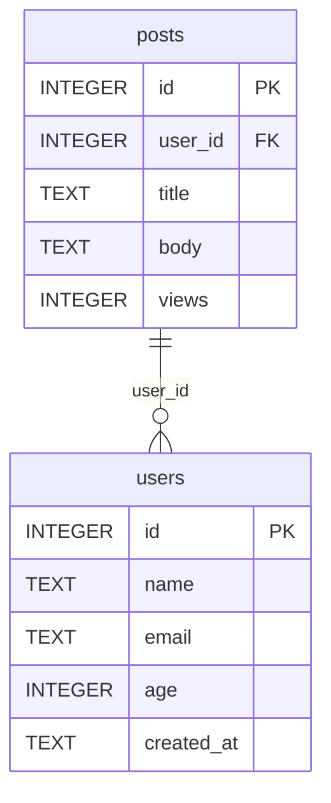

# 🛳️ SQLCockpit

**Language**: [简体中文](README.md) | [繁體中文](README.zh-Hant.md) | [English](README.en.md)

[](https://github.com/gitstq/SQLCockpit/actions/workflows/ci.yml)
[](https://opensource.org/licenses/MIT)
[](https://www.python.org/)
[](#-packaging--deployment)
[](#-core-features)

> **A zero-dependency, all-in-one terminal workbench for SQLite** — schema intelligence, SQL shell, import/export, database diffing, ER diagrams, health checks and query benchmarking in a single command.

---

## 🎉 Introduction

**SQLCockpit** is a terminal workbench for SQLite built **entirely on the Python standard library** (Zero-Dependency Terminal SQLite Workbench). It folds capabilities that normally live across a dozen separate tools into one out-of-the-box CLI: no database drivers, no GUI, no Node.js — just Python 3.9+ and `pip install .`, and you have a complete database cockpit.

**Real pain points it solves**:

- 😤 Want to peek inside a `.db` file? Usually that means downloading a heavyweight GUI tool or memorizing `sqlite3` incantations
- 😤 Moving a CSV into a database (or a table out of one) means bouncing between scripts and random online converters
- 😤 Two database versions drifted apart? Time to eyeball-diff `sqlite_master` dumps
- 😤 Need an ER diagram for the team? Either draw it by hand or pull in a pile of plotting dependencies
- 😤 Database "feels slow" but you don't know where to start: page fragmentation, missing primary keys, foreign-key violations

**Differentiators of this from-scratch implementation**:

- 🚀 **Truly zero dependencies**: standard library only (`sqlite3` / `cmd` / `curses` / `csv` / `json` …) — runs on any stock Python, ready for cloud CI
- 🧩 **One integrated workbench**: schema intelligence + interactive shell + import/export + database diff + ER diagrams + health doctor + benchmarking + TUI
- 🗺️ **Built-in ER diagram engine**: emit Mermaid `erDiagram` or Graphviz DOT with one command, ready to paste into docs
- 🩺 **Actionable health advice**: Doctor doesn't just report problems — it tells you to VACUUM, add primary keys, or switch to WAL
- 🖥️ **Cross-platform TUI**: full-screen `curses` cockpit on Unix/macOS; automatic menu fallback on Windows — **without installing a single extra package**
- 🌍 **Native-quality docs in three languages**: 简体中文 / 繁體中文 / English

**Inspiration**: GitHub Trending through 2026 keeps championing "local-first, terminal-native, single-file tools", with database clients and terminal experience tools taking up significant space (e.g. visidata, sqlite-utils). SQLCockpit was **independently developed** in that spirit, deliberately positioned as a one-stop cockpit for single-file SQLite databases, with clear differentiation in feature composition and interaction model.

---

## ✨ Core Features

| Feature | Description |
|---|---|
| 🔍 **Schema intelligence** | One command lists every table / view / index / trigger / foreign key / primary key, with column types, constraints and defaults |
| 💻 **Interactive SQL shell** | An enhanced `cmd`-based shell: multi-line statement buffering, `.tables` `.schema` `.count` `.format` `.limit` `.export` `.import` `.er` `.doctor` `.diff` `.bench` meta commands, history |
| 📤 **Multi-format import/export** | Export to `table` / `vertical` / `csv` / `json` / `jsonl` / `markdown`; import CSV (auto-detected delimiter) or JSON with **automatic type inference and table creation** |
| 🔀 **Database diffing** | Schema-level diff (tables / columns / indexes / views / triggers added, removed, changed) plus data-level diff (by primary key or row hash, with add/remove/change counts and samples) |
| 🗺️ **ER diagram generation** | Generate Mermaid `erDiagram` or Graphviz DOT straight from foreign keys, with PK / FK annotations |
| 🩺 **Health doctor** | `integrity_check` / `foreign_key_check` / `quick_check` + PRAGMA statistics + actionable maintenance advice (VACUUM / ANALYZE / WAL / add PK) |
| ⏱️ **Query benchmarking** | Read-only query timing: min / max / avg / p95 / throughput, with write-statement protection |
| 🖥️ **Full-screen TUI** | Three-pane `curses` cockpit (table tree / SQL editor / results), with an automatic menu fallback on Windows |
| 📦 **Zero dependencies** | 100% Python standard library, Python 3.9 – 3.13, Windows / macOS / Linux |

---

## 🚀 Quick Start

### Requirements

- **Python 3.9 or newer** (no third-party packages required)
- OS: Windows, macOS or Linux
- An existing `.db` / `.sqlite` file (or create one on the fly)

### Option 1: pip install (recommended)

```bash
git clone https://github.com/gitstq/SQLCockpit.git
cd SQLCockpit
pip install .

# the sqlcockpit command is now available
sqlcockpit --version
```

### Option 2: run from source, no install

```bash
git clone https://github.com/gitstq/SQLCockpit.git
cd SQLCockpit

# python -m works without installing anything
python -m sqlcockpit --version
python -m sqlcockpit open your_database.db
```

### Option 3: pipx isolated install

```bash
pipx install .
sqlcockpit shell your_database.db
```

### 30-second tour

```bash
# 1. overview of the database
sqlcockpit open demo.db

# 2. inspect the schema
sqlcockpit schema demo.db --table users

# 3. run some SQL
sqlcockpit query demo.db "select id, name from users limit 5" --format table

# 4. export a table
sqlcockpit export demo.db --table users --format csv --output users.csv

# 5. generate an ER diagram (Mermaid)
sqlcockpit er demo.db --format mermaid --output er.mmd

# 6. health check
sqlcockpit doctor demo.db

# 7. interactive shell / full-screen TUI
sqlcockpit shell demo.db
sqlcockpit tui demo.db
```

---

## 📖 Detailed Usage Guide

### Command overview

```
sqlcockpit <command> [options]

  open     Database overview (size / storage params / object stats / row counts)
  schema   Schema output (single table optional, six formats)
  query    Execute SQL (200 rows by default; --limit 0 for unlimited)
  export   Export a table / view to a file or stdout
  import   Import CSV / JSON into a table (type inference, auto-create)
  diff     Compare two databases (schema level; add --data for data level)
  er       Generate an ER diagram (mermaid / dot)
  doctor   Health checks and maintenance advice (--vacuum / --analyze)
  bench    Benchmark read-only queries
  shell    Interactive SQL shell
  tui      Full-screen TUI (auto-fallback to a menu without curses)
```

### 🔍 `open` — database overview

```bash
sqlcockpit open demo.db
```

```
Database : /path/to/demo.db (24.0 KB)
Size     : 24.0 KB
Engine   : SQLite 3.50.4
Storage  : page_size=4096 pages=6 freelist=0 journal=delete user_version=0
Objects  : 2 tables, 1 views, 1 indexes, 1 triggers
┌───────┬──────┬─────────┐
│ table │ rows │ columns │
├───────┼──────┼─────────┤
│ posts │    3 │       5 │
│ users │    3 │       5 │
└───────┴──────┴─────────┘
```

### 🧱 `schema` — structure reconnaissance

```bash
# whole-database schema
sqlcockpit schema demo.db

# one table only, JSON for downstream tooling
sqlcockpit schema demo.db --table users --format json

# Markdown output, ready to paste into docs
sqlcockpit schema demo.db --format markdown
```

Common options: `--format table|vertical|csv|json|jsonl|markdown`, `--output <file>`.

### ⚡ `query` — execute SQL

```bash
sqlcockpit query demo.db "select u.name, count(p.id) as posts from users u left join posts p on p.user_id = u.id group by u.id order by posts desc"
sqlcockpit query demo.db "select * from users" --format json --limit 0
```

- Returns at most 200 rows by default (`--limit 0` disables the cap)
- All six output formats supported; non-query statements (INSERT/UPDATE/DDL) print `OK`

### 📤 `export` / 📥 `import` — data in and out

```bash
# export a whole table to CSV
sqlcockpit export demo.db --table users --format csv --output users.csv

# conditional export in JSON-lines format
sqlcockpit export demo.db --table posts --where "views > 4" --format jsonl

# import CSV (delimiter auto-detected: , ; tab |; column types inferred; table auto-created)
sqlcockpit import demo.db --table scores --file scores.csv

# import a JSON array; pick replace / append when the table exists
sqlcockpit import demo.db --table scores --file scores.json --if-exists append
```

| Option | Description |
|---|---|
| `--table` | Target table (required) |
| `--file` | Source file path (required) |
| `--format` | `csv` or `json`; inferred from extension by default |
| `--if-exists` | `fail` (default) / `replace` / `append` |
| `--no-create` | Forbid automatic table creation |
| `--delimiter` | Manual CSV delimiter override |
| `--where` | (export) optional WHERE clause |

### 🔀 `diff` — compare two databases

```bash
# schema-level comparison
sqlcockpit diff old.db new.db

# schema + data comparison
sqlcockpit diff old.db new.db --data --format json
```

Sample output:

```
== Schema changes ==
┌───────────────┬────────┬─────────┐
│ kind          │ object │ detail  │
├───────────────┼────────┼─────────┤
│ table_added   │ tags   │         │
│ index_added   │ users  │ idx_age │
└───────────────┴────────┴─────────┘
== Data changes ==
┌───────┬───────┬────────┬─────────────┬─────────────┬──────────┐
│ table │ left  │ right  │ only_left   │ only_right  │ changed  │
├───────┼───────┼────────┼─────────────┼─────────────┼──────────┤
│ posts │     3 │      4 │           0 │           1 │        0 │
└───────┴───────┴────────┴─────────────┴─────────────┴──────────┘
identical: no
```

Data-level strategy: primary-key alignment when available, otherwise a multiset comparison of row-content hashes.

### 🗺️ `er` — ER diagram generation

```bash
sqlcockpit er demo.db --format mermaid --output er.mmd
sqlcockpit er demo.db --format dot --output er.dot
```

The Mermaid output pastes directly into [mermaid.live](https://mermaid.live) or any Mermaid-aware Markdown renderer:



DOT output renders with Graphviz: `dot -Tpng er.dot -o er.png`.

### 🩺 `doctor` — health inspection

```bash
sqlcockpit doctor demo.db
sqlcockpit doctor demo.db --format json
sqlcockpit doctor demo.db --vacuum --analyze   # run maintenance after checks
```

```
Database : /path/to/demo.db (24.0 KB)
Status   : HEALTHY
Integrity: ok
FK check : 0 violation(s)
Objects  : 2 tables, 1 views, 1 triggers
Storage  : page_size=4096 pages=6 freelist=0 journal=delete user_version=0

┌───────┬──────┬─────────┬─────────┬─────┬────────┐
│ table │ rows │ columns │ indexes │ fks │ has_pk │
├───────┼──────┼─────────┼─────────┼─────┼────────┤
│ posts │    3 │       5 │       1 │   1 │ yes    │
│ users │    3 │       5 │       1 │   0 │ yes    │
└───────┴──────┴─────────┴─────────┴─────┴────────┘

Suggestions:
  [info] journal_mode=delete, consider WAL for concurrency
  [info] user_version is 0, set it to track schema versions
```

When a critical issue is found the process exits with code `1`, ready to gate your CI pipeline.

### ⏱️ `bench` — query benchmarking

```bash
sqlcockpit bench demo.db "select count(*) from posts join users on users.id = posts.user_id" --runs 20
```

```
┌────────────┬────────┐
│ metric     │ value  │
├────────────┼────────┤
│ runs       │ 20     │
│ rows       │ 3      │
│ min        │ 0.412 ms│
│ max        │ 1.033 ms│
│ avg        │ 0.548 ms│
│ p95        │ 0.902 ms│
│ throughput │ 5474.5 rows/s │
└────────────┴────────┘
```

Safety guard: `bench` refuses to run write statements (INSERT/UPDATE/DELETE/DDL/PRAGMA…).

### 💻 `shell` — interactive SQL shell

```bash
sqlcockpit shell demo.db
```

```
sqlcockpit> .tables
┌───────┬───────┬───────┐
│ name  │ type  │ rows  │
├───────┼───────┼───────┤
│ posts │ table │     3 │
│ users │ table │     3 │
└───────┴───────┴───────┘
sqlcockpit> select name from users where age > 28;
┌───────┐
│ name  │
├───────┤
│ Alice │
│ Carol │
└───────┘
sqlcockpit> .format json
output format: json
sqlcockpit> .quit
bye
```

Meta commands: `.tables` `.schema [table]` `.indexes [table]` `.count table` `.format fmt` `.limit N` `.export table [file]` `.import table file [--if-exists ...]` `.er [mermaid|dot]` `.doctor` `.diff other.db` `.bench SQL` `.quit` / `.exit`

### 🖥️ `tui` — full-screen cockpit

```bash
sqlcockpit tui demo.db
```

- Left pane: table list (↑/↓ to move, Enter to view schema)
- Top right: SQL editor (type freely, F2 to run)
- Bottom right: results
- Keys: `Tab` switch pane, `F2` run, `F5` show table structure, `q` quit
- On Windows without the `curses` module it automatically degrades to a numbered menu — no feature is lost

> 📷 **Screenshot / demo GIF placeholder**: `docs/screenshots/cockpit.png` (community PRs with real screenshots are welcome)

### 🧪 Typical scenarios

**Scenario 1: inherit an unfamiliar `.db` file**

```bash
sqlcockpit open app.db && sqlcockpit schema app.db --format markdown > schema.md && sqlcockpit er app.db --output er.mmd && sqlcockpit doctor app.db
```

**Scenario 2: seed a test database**

```bash
sqlcockpit import test.db --table users --file fixtures/users.csv --if-exists replace
```

**Scenario 3: diff staging against production before release**

```bash
sqlcockpit diff prod.db staging.db --data --format json > release-diff.json
```

**Scenario 4: hunt down slow queries**

```bash
sqlcockpit bench app.db "select * from orders where status = 'pending'" --runs 50 --format json
```

---

## 💡 Design Rationale & Roadmap

### Design principles

1. **The standard library is the dependency**: "zero dependencies" is treated as an architectural constraint, not a marketing word — every feature is forced into stock Python capabilities (`sqlite3` for the engine, `cmd` for the shell, `curses` for the TUI, `csv/json` for serialization).
2. **Cloud-first**: builds, tests and packaging all run on GitHub Actions runners; locally you only do read-only syntax checks.
3. **Composable CLI**: every subcommand does one thing well, with pipeable, redirectable, script-friendly output (JSON is a first-class format).
4. **Safe by default**: read commands open databases read-only; `bench` blocks write statements; `doctor` maintenance actions are strictly opt-in.

### Why these technologies

| Choice | Rationale |
|---|---|
| Python standard library | Zero install cost, 3.9–3.13 compatible, identical behavior across platforms |
| `sqlite3` module | SQLite is the de-facto standard for single-file databases; CPython ships the binding |
| `cmd` module | Stock interactive-shell framework, so we focus on meta commands instead of REPL plumbing |
| `curses` + menu fallback | The best compromise between a full-screen Unix experience and zero dependencies on Windows |
| `unittest` | Consistent with the standard-library strategy; CI needs no extra toolchain |

### Roadmap

- **v1.1**: paginated `query` results; a `\watch` meta command for periodic refresh in the shell
- **v1.2**: SQLite virtual table (FTS5) helpers; `.dump` logical backup / restore
- **v1.3**: pluggable export targets (Excel / Parquet via cloud CI artifacts)
- **v2.0**: mouse support and editable result sets in the TUI

### Where the community can help

New output formats, shell meta commands, TUI interaction polish, documentation translations (Japanese / Korean / Spanish) and edge-case tests are all welcome — see [CONTRIBUTING.md](CONTRIBUTING.md).

---

## 📦 Packaging & Deployment

### Deploy as a CLI tool

```bash
# any of these
pip install .            # install from the current directory
pipx install .           # isolated environment install
python -m build          # build sdist + wheel (pip install build first)
pip install dist/*.whl   # install the built artifact
```

Installing provides the `sqlcockpit` command; without installing, `python -m sqlcockpit` is fully equivalent.

### Integrate as a library

SQLCockpit's internal API is equally dependency-free and importable:

```python
from sqlcockpit.db import Database
from sqlcockpit.erdiagram import build_model, to_mermaid

with Database("app.db") as db:
    print(db.tables())
    print(to_mermaid(build_model(db)))
```

### CI pipeline (GitHub Actions)

The repository ships `.github/workflows/ci.yml`, running on a matrix of `ubuntu-latest` / `windows-latest` / `macos-latest` × Python 3.9–3.13:

1. **syntax**: `python -m compileall -q sqlcockpit tests` full syntax validation
2. **test**: `python -m unittest discover -s tests -v` unit tests + CLI smoke tests
3. **package**: `python -m build` builds distributions, installs the wheel and verifies the `sqlcockpit` console entry point

### Compatibility

| Platform | Python 3.9 | 3.10 | 3.11 | 3.12 | 3.13 |
|---|---|---|---|---|---|
| Windows | ✅ | ✅ | ✅ | ✅ | ✅ |
| macOS | ✅ | ✅ | ✅ | ✅ | ✅ |
| Linux | ✅ | ✅ | ✅ | ✅ | ✅ |

> On Windows, the full-screen TUI needs `pip install windows-curses` for the `curses` module; **SQLCockpit never forces that dependency** — without it, `sqlcockpit tui` automatically falls back to menu mode.

---

## 🤝 Contributing

- Before opening a PR, make sure this passes locally: `python -m compileall -q sqlcockpit tests && python -m unittest discover -s tests -v`
- Commit messages follow the Angular convention: `feat:` / `fix:` / `docs:` / `refactor:` / `test:` / `chore:`
- New features must ship with unit tests; documentation must be updated in all three languages
- In issues, include your OS, Python version, the exact command and full error output — **never** attach real databases or secrets
- Full guidelines: [CONTRIBUTING.md](CONTRIBUTING.md)

---

## 📄 License

This project is open source under the **MIT License**. You may use, copy, modify, merge, publish, distribute, sublicense and/or sell copies of the software, provided the copyright notice and permission notice appear in all copies. See [LICENSE](LICENSE) for details.

```
Copyright (c) 2026 gitstq
```

---

🛳️ **SQLCockpit** — may you never have to open a heavyweight GUI just to look at a `.db` file. Made with ❤️ and 100% standard library.
