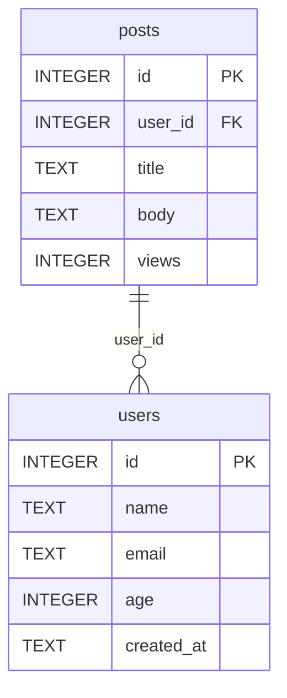

# 🛳️ SQLCockpit

**语言 / Language / 語言**: [简体中文](README.md) | [繁體中文](README.zh-Hant.md) | [English](README.en.md)

[](https://github.com/gitstq/SQLCockpit/actions/workflows/ci.yml)
[](https://opensource.org/licenses/MIT)
[](https://www.python.org/)
[](#-打包与部署指南)
[](#-核心特性)

> **零依赖的终端 SQLite 一体化工作台** ——  Schema 侦察、SQL Shell、导入导出、双库对比、ER 图生成、健康巡检、查询基准，一个命令全部搞定。

---

## 🎉 项目介绍

**SQLCockpit** 是一款**纯 Python 标准库**实现的 SQLite 终端工作台（Zero-Dependency Terminal SQLite Workbench）。它把日常数据库开发运维中散落在十几个工具里的能力，收拢进一个开箱即用的命令行程序：不需要安装数据库驱动、不需要 GUI、不需要 Node.js，只要有 Python 3.9+，`pip install .` 之后立即拥有完整的数据库驾驶舱。

**它解决的真实痛点**：

- 😤 想看一个 `.db` 文件里有什么，只能下载笨重的 GUI 工具，或者记住一串 `sqlite3` 命令
- 😤 导个 CSV 进库、导张表出来，要在多个脚本和在线转换网站之间来回倒腾
- 😤 两个版本的数据库哪里变了？靠肉眼比对 `sqlite_master` 导出文件
- 😤 想给团队画一张 ER 图，要么手动画，要么引入一堆绘图依赖
- 😤 数据库"感觉变慢了"，不知道从哪查起：碎片、缺主键、外键违规一塌糊涂

**自研差异化亮点**：

- 🚀 **真·零依赖**：仅用标准库（`sqlite3` / `cmd` / `curses` / `csv` / `json`……），任何 Python 环境即刻运行，CI 云端即测即用
- 🧩 **一体化工作台**：Schema 侦察 + 交互 Shell + 导入导出 + 双库 Diff + ER 图 + 健康医生 + 查询基准 + TUI，一个工具全覆盖
- 🗺️ **内置 ER 图引擎**：一条命令输出 Mermaid `erDiagram` 或 Graphviz DOT，直接粘进文档即用
- 🩺 **可执行的健康建议**：Doctor 不只报"有问题"，还告诉你"该 VACUUM / 该补主键 / 该开 WAL"
- 🖥️ **全平台 TUI**：Unix/macOS 走 `curses` 全屏驾驶舱；Windows 无 `curses` 时自动降级为菜单模式，**不引入任何第三方包**
- 🌍 **母语级三语文档**：简体中文 / 繁體中文 / English 完整覆盖

**灵感来源**：2026 年 GitHub Trending 持续吹拂「本地优先、终端原生、单文件工具」之风，数据库客户端与终端体验类工具占据显著版面（如 visidata、sqlite-utils 等）。SQLCockpit 在此趋势下**独立自研**，聚焦"SQLite 单文件库的一站式驾驶舱"这一定位，与上述项目在功能组合与交互形态上做出明确差异化。

---

## ✨ 核心特性

| 特性 | 说明 |
|---|---|
| 🔍 **Schema 智能侦察** | 一键列出全部表 / 视图 / 索引 / 触发器 / 外键 / 主键，列类型、约束、默认值一目了然 |
| 💻 **交互式 SQL Shell** | 基于 `cmd` 的增强 Shell：多行语句缓冲、`.tables` `.schema` `.count` `.format` `.limit` `.export` `.import` `.er` `.doctor` `.diff` `.bench` 元命令、命令历史 |
| 📤 **多格式导入导出** | 导出支持 `table` / `vertical` / `csv` / `json` / `jsonl` / `markdown` 六种格式；导入支持 CSV（自动嗅探分隔符）与 JSON，**自动类型推断 + 自动建表** |
| 🔀 **双库 Diff** | Schema 级对比（表 / 列 / 索引 / 视图 / 触发器增删改）+ 数据级对比（按主键或行哈希，输出增 / 删 / 改计数与样本） |
| 🗺️ **ER 图生成** | 从外键关系自动生成 Mermaid `erDiagram` 或 Graphviz DOT，PK / FK 自动标注 |
| 🩺 **健康医生 Doctor** | `integrity_check` / `foreign_key_check` / `quick_check` + PRAGMA 统计 + 可执行维护建议（VACUUM / ANALYZE / WAL / 补主键） |
| ⏱️ **查询基准 Bench** | 只读查询计时：min / max / avg / p95 / 吞吐量，内置写语句防护 |
| 🖥️ **全屏 TUI** | `curses` 三 pane 驾驶舱（表树 / SQL 编辑 / 结果），Windows 自动降级菜单模式 |
| 📦 **零依赖** | 100% Python 标准库，Python 3.9 – 3.13 全版本兼容，Windows / macOS / Linux 全平台 |

---

## 🚀 快速开始

### 环境要求

- **Python 3.9 或更高版本**（无需任何第三方包）
- 操作系统：Windows / macOS / Linux 均可
- 一个现成的 `.db` / `.sqlite` 文件（没有也可以现场创建）

### 方式一：pip 安装（推荐）

```bash
# 克隆后本地安装（不会安装任何第三方依赖）
git clone https://github.com/gitstq/SQLCockpit.git
cd SQLCockpit
pip install .

# 安装后即可使用 sqlcockpit 命令
sqlcockpit --version
```

### 方式二：免安装，源码直接跑

```bash
git clone https://github.com/gitstq/SQLCockpit.git
cd SQLCockpit

# 用 python -m 方式运行，无需安装
python -m sqlcockpit --version
python -m sqlcockpit open your_database.db
```

### 方式三：pipx 隔离安装

```bash
pipx install .
sqlcockpit shell your_database.db
```

### 30 秒上手

```bash
# 1. 看一眼数据库全貌
sqlcockpit open demo.db

# 2. 查 schema
sqlcockpit schema demo.db --table users

# 3. 跑一条 SQL
sqlcockpit query demo.db "select id, name from users limit 5" --format table

# 4. 导出一张表
sqlcockpit export demo.db --table users --format csv --output users.csv

# 5. 生成 ER 图（Mermaid）
sqlcockpit er demo.db --format mermaid --output er.mmd

# 6. 健康巡检
sqlcockpit doctor demo.db

# 7. 进入交互 Shell / 全屏 TUI
sqlcockpit shell demo.db
sqlcockpit tui demo.db
```

---

## 📖 详细使用指南

### 命令总览

```
sqlcockpit <command> [options]

  open     数据库总览（大小 / 存储参数 / 对象统计 / 各表行数）
  schema   Schema 结构输出（可限定单表，六种格式）
  query    执行 SQL（默认限 200 行，--limit 0 表示不限）
  export   导出表 / 视图到文件或标准输出
  import   导入 CSV / JSON 到表（自动推断类型、自动建表）
  diff     对比两个数据库（schema 级，--data 追加数据级）
  er       生成 ER 图（mermaid / dot）
  doctor   健康检查与维护建议（--vacuum / --analyze 可执行维护）
  bench    只读查询基准测试
  shell    交互式 SQL Shell
  tui      全屏 TUI（无 curses 环境自动降级为菜单）
```

### 🔍 `open` —— 数据库总览

```bash
sqlcockpit open demo.db
```

```
Database : /path/to/demo.db (24.0 KB)
Size     : 24.0 KB
Engine   : SQLite 3.50.4
Storage  : page_size=4096 pages=6 freelist=0 journal=delete user_version=0
Objects  : 2 tables, 1 views, 1 indexes, 1 triggers
┌───────┬──────┬─────────┐
│ table │ rows │ columns │
├───────┼──────┼─────────┤
│ posts │    3 │       5 │
│ users │    3 │       5 │
└───────┴──────┴─────────┘
```

### 🧱 `schema` —— 结构侦察

```bash
# 全库 schema
sqlcockpit schema demo.db

# 只看一张表，输出 JSON 喂给别的程序
sqlcockpit schema demo.db --table users --format json

# 输出 Markdown，直接贴进文档
sqlcockpit schema demo.db --format markdown
```

通用参数：`--format table|vertical|csv|json|jsonl|markdown`、`--output <文件>`。

### ⚡ `query` —— 执行 SQL

```bash
sqlcockpit query demo.db "select u.name, count(p.id) as posts from users u left join posts p on p.user_id = u.id group by u.id order by posts desc"
sqlcockpit query demo.db "select * from users" --format json --limit 0
```

- 默认最多返回 200 行（`--limit 0` 关闭限制）
- 支持全部六种输出格式；非查询语句（INSERT/UPDATE/DDL）执行后返回 `OK`

### 📤 `export` / 📥 `import` —— 数据进出

```bash
# 导出整表为 CSV
sqlcockpit export demo.db --table users --format csv --output users.csv

# 带条件导出 + JSON 行格式
sqlcockpit export demo.db --table posts --where "views > 4" --format jsonl

# 导入 CSV（自动嗅探分隔符 , ; \t |，自动推断列类型并建表）
sqlcockpit import demo.db --table scores --file scores.csv

# 导入 JSON 数组；目标表已存在时可选择 replace / append
sqlcockpit import demo.db --table scores --file scores.json --if-exists append
```

| 参数 | 说明 |
|---|---|
| `--table` | 目标表名（必填） |
| `--file` | 源文件路径（必填） |
| `--format` | `csv` 或 `json`，缺省按扩展名推断 |
| `--if-exists` | `fail`（默认）/ `replace` / `append` |
| `--no-create` | 禁止自动建表 |
| `--delimiter` | 手动指定 CSV 分隔符 |
| `--where` | （export）可选 WHERE 子句 |

### 🔀 `diff` —— 双库对比

```bash
# schema 级对比
sqlcockpit diff old.db new.db

# schema + 数据双重对比
sqlcockpit diff old.db new.db --data --format json
```

输出示例：

```
== Schema changes ==
┌───────────────┬────────┬─────────┐
│ kind          │ object │ detail  │
├───────────────┼────────┼─────────┤
│ table_added   │ tags   │         │
│ index_added   │ users  │ idx_age │
└───────────────┴────────┴─────────┘
== Data changes ==
┌───────┬───────┬────────┬─────────────┬─────────────┬──────────┐
│ table │ left  │ right  │ only_left   │ only_right  │ changed  │
├───────┼───────┼────────┼─────────────┼─────────────┼──────────┤
│ posts │     3 │      4 │           0 │           1 │        0 │
└───────┴───────┴────────┴─────────────┴─────────────┴──────────┘
identical: no
```

数据级对比策略：有主键按主键对齐，无主键按行内容哈希集合对比。

### 🗺️ `er` —— ER 图生成

```bash
sqlcockpit er demo.db --format mermaid --output er.mmd
sqlcockpit er demo.db --format dot --output er.dot
```

生成的 Mermaid 可直接粘贴到 [mermaid.live](https://mermaid.live) 或任何支持 Mermaid 的 Markdown 渲染器：



DOT 格式可用 Graphviz 渲染：`dot -Tpng er.dot -o er.png`。

### 🩺 `doctor` —— 健康巡检

```bash
sqlcockpit doctor demo.db
sqlcockpit doctor demo.db --format json
sqlcockpit doctor demo.db --vacuum --analyze   # 检查后直接执行维护
```

```
Database : /path/to/demo.db (24.0 KB)
Status   : HEALTHY
Integrity: ok
FK check : 0 violation(s)
Objects  : 2 tables, 1 views, 1 triggers
Storage  : page_size=4096 pages=6 freelist=0 journal=delete user_version=0

┌───────┬──────┬─────────┬─────────┬─────┬────────┐
│ table │ rows │ columns │ indexes │ fks │ has_pk │
├───────┼──────┼─────────┼─────────┼─────┼────────┤
│ posts │    3 │       5 │       1 │   1 │ yes    │
│ users │    3 │       5 │       1 │   0 │ yes    │
└───────┴──────┴─────────┴─────────┴─────┴────────┘

Suggestions:
  [info] journal_mode=delete, consider WAL for concurrency
  [info] user_version is 0, set it to track schema versions
```

存在 critical 级问题时进程退出码为 `1`，可直接接入 CI 门禁。

### ⏱️ `bench` —— 查询基准

```bash
sqlcockpit bench demo.db "select count(*) from posts join users on users.id = posts.user_id" --runs 20
```

```
┌────────────┬────────┐
│ metric     │ value  │
├────────────┼────────┤
│ runs       │ 20     │
│ rows       │ 3      │
│ min        │ 0.412 ms│
│ max        │ 1.033 ms│
│ avg        │ 0.548 ms│
│ p95        │ 0.902 ms│
│ throughput │ 5474.5 rows/s │
└────────────┴────────┘
```

安全护栏：`bench` 拒绝执行任何写语句（INSERT/UPDATE/DELETE/DDL/PRAGMA…）。

### 💻 `shell` —— 交互式 SQL Shell

```bash
sqlcockpit shell demo.db
```

```
sqlcockpit> .tables
┌───────┬───────┬───────┐
│ name  │ type  │ rows  │
├───────┼───────┼───────┤
│ posts │ table │     3 │
│ users │ table │     3 │
└───────┴───────┴───────┘
sqlcockpit> select name from users where age > 28;
┌───────┐
│ name  │
├───────┤
│ Alice │
│ Carol │
└───────┘
sqlcockpit> .format json
output format: json
sqlcockpit> .quit
bye
```

元命令清单：`.tables` `.schema [表]` `.indexes [表]` `.count 表` `.format 格式` `.limit N` `.export 表 [文件]` `.import 表 文件 [--if-exists ...]` `.er [mermaid|dot]` `.doctor` `.diff 另一个库` `.bench SQL` `.quit` / `.exit`

### 🖥️ `tui` —— 全屏驾驶舱

```bash
sqlcockpit tui demo.db
```

- 左栏：表清单（↑/↓ 选择，Enter 查看 schema）
- 右上：SQL 编辑区（直接键入，F2 执行）
- 右下：结果区
- 快捷键：`Tab` 切换面板、`F2` 执行、`F5` 查看表结构、`q` 退出
- Windows 无 `curses` 模块时自动降级为 numbered menu，功能不缺席

> 📷 **截图 / 演示动图占位**：`docs/screenshots/cockpit.png`（欢迎社区 PR 补充真实截图）

### 🧪 典型场景剧本

**场景 1：接手一个陌生的 `.db` 文件**

```bash
sqlcockpit open app.db && sqlcockpit schema app.db --format markdown > schema.md && sqlcockpit er app.db --output er.mmd && sqlcockpit doctor app.db
```

**场景 2：给测试库灌入基准数据**

```bash
sqlcockpit import test.db --table users --file fixtures/users.csv --if-exists replace
```

**场景 3：发版前对比预发与生产库**

```bash
sqlcockpit diff prod.db staging.db --data --format json > release-diff.json
```

**场景 4：把慢查询揪出来**

```bash
sqlcockpit bench app.db "select * from orders where status = 'pending'" --runs 50 --format json
```

---

## 💡 设计思路与迭代规划

### 设计理念

1. **标准库即依赖**：把"零依赖"当作架构约束而非营销词——倒逼所有功能用 Python 自带能力实现（`sqlite3` 做引擎、`cmd` 做 Shell、`curses` 做 TUI、`csv/json` 做序列化）。
2. **云端优先**：构建、测试、打包全部交给 GitHub Actions Runner；本地只做只读式语法校验。
3. **可组合的命令行**：每个子命令都能独立完成一件事，输出可管道、可重定向、可被脚本消费（JSON 格式是一等公民）。
4. **安全默认**：读命令默认只读打开库；`bench` 拦截写语句；`doctor` 的维护动作必须显式 opt-in。

### 技术选型原因

| 选择 | 理由 |
|---|---|
| Python 标准库 | 零安装成本，3.9–3.13 全兼容，跨平台无差异 |
| `sqlite3` 模块 | SQLite 本身就是单文件数据库事实标准，CPython 内置绑定 |
| `cmd` 模块 | 标准库交互 Shell 框架，专注元命令而非 REPL 细节 |
| `curses` + 降级菜单 | Unix 全屏体验与 Windows 零依赖之间的最优解 |
| `unittest` | 与标准库策略一致，CI 无需额外工具链 |

### 迭代路线图

- **v1.1**：`query` 结果分页浏览；Shell 内 `\watch` 定时刷新
- **v1.2**：SQLite 虚拟表（FTS5）辅助命令；`.dump` 逻辑备份 / 恢复
- **v1.3**：可插拔导出目标（Excel / Parquet 走云端 CI 产物）
- **v2.0**：TUI 引入鼠标支持与结果集编辑回写

### 社区贡献方向

欢迎围绕：新输出格式、Shell 元命令、TUI 交互优化、文档翻译（日 / 韩 / 西语）、边界场景测试用例提交 PR，详见 [CONTRIBUTING.md](CONTRIBUTING.md)。

---

## 📦 打包与部署指南

### 作为命令行工具部署

```bash
# 任选其一
pip install .            # 当前目录安装
pipx install .           # 隔离环境安装
python -m build          # 构建 sdist + wheel（需 pip install build）
pip install dist/*.whl   # 安装构建产物
```

安装后获得 `sqlcockpit` 命令；未安装时 `python -m sqlcockpit` 完全等价。

### 作为库集成到你的项目

SQLCockpit 的内部 API 同样零依赖、可直接引入：

```python
from sqlcockpit.db import Database
from sqlcockpit.erdiagram import build_model, to_mermaid

with Database("app.db") as db:
    print(db.tables())
    print(to_mermaid(build_model(db)))
```

### CI 流水线（GitHub Actions）

仓库自带 `.github/workflows/ci.yml`，在 `ubuntu-latest` / `windows-latest` / `macos-latest` × Python 3.9–3.13 矩阵上执行：

1. **syntax**：`python -m compileall -q sqlcockpit tests` 全量语法校验
2. **test**：`python -m unittest discover -s tests -v` 单元测试 + CLI 冒烟
3. **package**：`python -m build` 构建分发包，安装 wheel 并验证 `sqlcockpit` 控制台入口

### 兼容环境

| 平台 | Python 3.9 | 3.10 | 3.11 | 3.12 | 3.13 |
|---|---|---|---|---|---|
| Windows | ✅ | ✅ | ✅ | ✅ | ✅ |
| macOS | ✅ | ✅ | ✅ | ✅ | ✅ |
| Linux | ✅ | ✅ | ✅ | ✅ | ✅ |

> Windows 的 `curses` 需要额外 `pip install windows-curses` 才能启用全屏 TUI；**SQLCockpit 不强制该依赖**，未安装时 `sqlcockpit tui` 自动降级为菜单模式。

---

## 🤝 贡献指南

- 提交 PR 前请本地通过：`python -m compileall -q sqlcockpit tests && python -m unittest discover -s tests -v`
- 提交信息遵循 Angular 规范：`feat:` / `fix:` / `docs:` / `refactor:` / `test:` / `chore:`
- 新功能必须附带单元测试；文档需同步更新三语版本
- Issue 中请包含 OS、Python 版本、完整命令与报错，**切勿**附带真实数据库或密钥
- 完整规范见 [CONTRIBUTING.md](CONTRIBUTING.md)

---

## 📄 开源协议说明

本项目基于 **MIT License** 开源，你可以自由地使用、复制、修改、合并、发布、分发、再授权及销售本软件的副本，唯需在所有副本中包含版权声明与许可声明。详见 [LICENSE](LICENSE)。

```
Copyright (c) 2026 gitstq
```

---

🛳️ **SQLCockpit** —— 愿你永远不必为一个 `.db` 文件打开笨重的 GUI。Made with ❤️ and 100% standard library.
