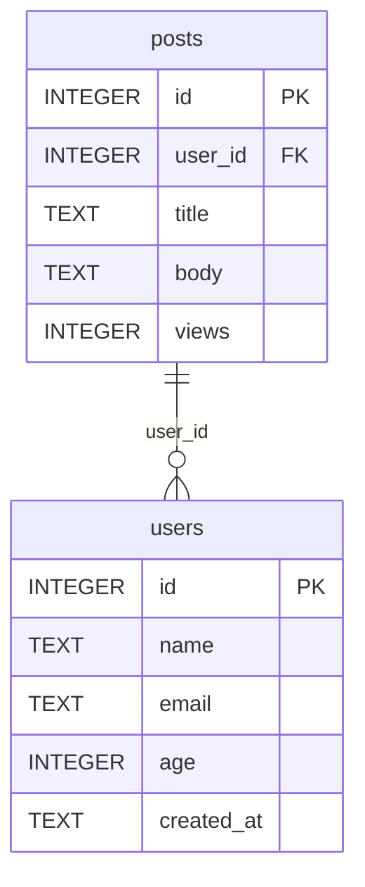

# 🛳️ SQLCockpit

**語言 / Language / 语言**: [简体中文](README.md) | [繁體中文](README.zh-Hant.md) | [English](README.en.md)

[](https://github.com/gitstq/SQLCockpit/actions/workflows/ci.yml)
[](https://opensource.org/licenses/MIT)
[](https://www.python.org/)
[](#-打包與部署指南)
[](#-核心特性)

> **零依賴的終端機 SQLite 一體化工作台** —— Schema 偵察、SQL Shell、匯入匯出、雙庫比對、ER 圖產生、健康巡檢、查詢基準，一條命令全部搞定。

---

## 🎉 專案介紹

**SQLCockpit** 是一款**純 Python 標準函式庫**實作的 SQLite 終端機工作台（Zero-Dependency Terminal SQLite Workbench）。它把日常資料庫開發維運中散落在十幾個工具裡的能力，收攏進一個開箱即用的命令列程式：不需要安裝資料庫驅動、不需要 GUI、不需要 Node.js，只要有 Python 3.9+，`pip install .` 之後立即擁有完整的資料庫駕駛艙。

**它解決的真實痛點**：

- 😤 想看一個 `.db` 檔案裡有什麼，只能下載笨重的 GUI 工具，或是記住一串 `sqlite3` 指令
- 😤 匯個 CSV 進資料庫、匯張表出來，要在多個腳本和線上轉換網站之間來回倒騰
- 😤 兩個版本的資料庫哪裡變了？靠肉眼比對 `sqlite_master` 匯出檔案
- 😤 想幫團隊畫一張 ER 圖，要麼手動畫，要麼引入一堆繪圖依賴
- 😤 資料庫「感覺變慢了」，不知道從哪查起：碎片、缺主鍵、外鍵違規一塌糊塗

**自研差異化亮點**：

- 🚀 **真·零依賴**：僅用標準函式庫（`sqlite3` / `cmd` / `curses` / `csv` / `json`……），任何 Python 環境即刻執行，CI 雲端即測即用
- 🧩 **一體化工作台**：Schema 偵察 + 互動 Shell + 匯入匯出 + 雙庫 Diff + ER 圖 + 健康醫生 + 查詢基準 + TUI，一個工具全覆蓋
- 🗺️ **內建 ER 圖引擎**：一條命令輸出 Mermaid `erDiagram` 或 Graphviz DOT，直接貼進文件即用
- 🩺 **可執行的健康建議**：Doctor 不只回報「有問題」，還會告訴你「該 VACUUM / 該補主鍵 / 該開 WAL」
- 🖥️ **全平台 TUI**：Unix/macOS 走 `curses` 全螢幕駕駛艙；Windows 無 `curses` 時自動降級為選單模式，**不引入任何第三方套件**
- 🌍 **母語級三語文件**：简体中文 / 繁體中文 / English 完整覆蓋

**靈感來源**：2026 年 GitHub Trending 持續吹拂「本地優先、終端機原生、單檔工具」之風，資料庫客戶端與終端機體驗類工具佔據顯著版面（如 visidata、sqlite-utils 等）。SQLCockpit 在此趨勢下**獨立自研**，聚焦「SQLite 單檔資料庫的一站式駕駛艙」這一定位，與上述專案在功能組合與互動形態上做出明確差異化。

---

## ✨ 核心特性

| 特性 | 說明 |
|---|---|
| 🔍 **Schema 智慧偵察** | 一鍵列出全部資料表 / 檢視表 / 索引 / 觸發器 / 外來鍵 / 主鍵，欄位型別、約束、預設值一目了然 |
| 💻 **互動式 SQL Shell** | 基於 `cmd` 的增強 Shell：多行陳述式緩衝、`.tables` `.schema` `.count` `.format` `.limit` `.export` `.import` `.er` `.doctor` `.diff` `.bench` 中繼命令、命令歷史 |
| 📤 **多格式匯入匯出** | 匯出支援 `table` / `vertical` / `csv` / `json` / `jsonl` / `markdown` 六種格式；匯入支援 CSV（自動偵測分隔符號）與 JSON，**自動型別推斷 + 自動建表** |
| 🔀 **雙庫 Diff** | Schema 級比對（資料表 / 欄位 / 索引 / 檢視表 / 觸發器增刪改）+ 資料級比對（依主鍵或行雜湊，輸出增 / 刪 / 改計數與樣本） |
| 🗺️ **ER 圖產生** | 從外來鍵關係自動產生 Mermaid `erDiagram` 或 Graphviz DOT，PK / FK 自動標註 |
| 🩺 **健康醫生 Doctor** | `integrity_check` / `foreign_key_check` / `quick_check` + PRAGMA 統計 + 可執行維護建議（VACUUM / ANALYZE / WAL / 補主鍵） |
| ⏱️ **查詢基準 Bench** | 唯讀查詢計時：min / max / avg / p95 / 吞吐量，內建寫入陳述式防護 |
| 🖥️ **全螢幕 TUI** | `curses` 三 pane 駕駛艙（資料表樹 / SQL 編輯 / 結果），Windows 自動降級選單模式 |
| 📦 **零依賴** | 100% Python 標準函式庫，Python 3.9 – 3.13 全版本相容，Windows / macOS / Linux 全平台 |

---

## 🚀 快速開始

### 環境需求

- **Python 3.9 或更高版本**（無需任何第三方套件）
- 作業系統：Windows / macOS / Linux 皆可
- 一個現成的 `.db` / `.sqlite` 檔案（沒有也可以現場建立）

### 方式一：pip 安裝（推薦）

```bash
#  clone 後本地安裝（不會安裝任何第三方依賴）
git clone https://github.com/gitstq/SQLCockpit.git
cd SQLCockpit
pip install .

# 安裝後即可使用 sqlcockpit 命令
sqlcockpit --version
```

### 方式二：免安裝，原始碼直接跑

```bash
git clone https://github.com/gitstq/SQLCockpit.git
cd SQLCockpit

# 用 python -m 方式執行，無需安裝
python -m sqlcockpit --version
python -m sqlcockpit open your_database.db
```

### 方式三：pipx 隔離安裝

```bash
pipx install .
sqlcockpit shell your_database.db
```

### 30 秒上手

```bash
# 1. 看一眼資料庫全貌
sqlcockpit open demo.db

# 2. 查 schema
sqlcockpit schema demo.db --table users

# 3. 跑一條 SQL
sqlcockpit query demo.db "select id, name from users limit 5" --format table

# 4. 匯出一張表
sqlcockpit export demo.db --table users --format csv --output users.csv

# 5. 產生 ER 圖（Mermaid）
sqlcockpit er demo.db --format mermaid --output er.mmd

# 6. 健康巡檢
sqlcockpit doctor demo.db

# 7. 進入互動 Shell / 全螢幕 TUI
sqlcockpit shell demo.db
sqlcockpit tui demo.db
```

---

## 📖 詳細使用指南

### 命令總覽

```
sqlcockpit <command> [options]

  open     資料庫總覽（大小 / 儲存參數 / 物件統計 / 各資料表行數）
  schema   Schema 結構輸出（可限定單表，六種格式）
  query    執行 SQL（預設限 200 行，--limit 0 表示不限）
  export   匯出資料表 / 檢視表到檔案或標準輸出
  import   匯入 CSV / JSON 到資料表（自動推斷型別、自動建表）
  diff     比對兩個資料庫（schema 級，--data 追加資料級）
  er       產生 ER 圖（mermaid / dot）
  doctor   健康檢查與維護建議（--vacuum / --analyze 可執行維護）
  bench    唯讀查詢基準測試
  shell    互動式 SQL Shell
  tui      全螢幕 TUI（無 curses 環境自動降級為選單）
```

### 🔍 `open` —— 資料庫總覽

```bash
sqlcockpit open demo.db
```

```
Database : /path/to/demo.db (24.0 KB)
Size     : 24.0 KB
Engine   : SQLite 3.50.4
Storage  : page_size=4096 pages=6 freelist=0 journal=delete user_version=0
Objects  : 2 tables, 1 views, 1 indexes, 1 triggers
┌───────┬──────┬─────────┐
│ table │ rows │ columns │
├───────┼──────┼─────────┤
│ posts │    3 │       5 │
│ users │    3 │       5 │
└───────┴──────┴─────────┘
```

### 🧱 `schema` —— 結構偵察

```bash
# 全庫 schema
sqlcockpit schema demo.db

# 只看一張表，輸出 JSON 餵給別的程式
sqlcockpit schema demo.db --table users --format json

# 輸出 Markdown，直接貼進文件
sqlcockpit schema demo.db --format markdown
```

通用參數：`--format table|vertical|csv|json|jsonl|markdown`、`--output <檔案>`。

### ⚡ `query` —— 執行 SQL

```bash
sqlcockpit query demo.db "select u.name, count(p.id) as posts from users u left join posts p on p.user_id = u.id group by u.id order by posts desc"
sqlcockpit query demo.db "select * from users" --format json --limit 0
```

- 預設最多回傳 200 行（`--limit 0` 關閉限制）
- 支援全部六種輸出格式；非查詢陳述式（INSERT/UPDATE/DDL）執行後回傳 `OK`

### 📤 `export` / 📥 `import` —— 資料進出

```bash
# 匯出整表為 CSV
sqlcockpit export demo.db --table users --format csv --output users.csv

# 帶條件匯出 + JSON 行格式
sqlcockpit export demo.db --table posts --where "views > 4" --format jsonl

# 匯入 CSV（自動偵測分隔符號 , ; \t |，自動推斷欄位型別並建表）
sqlcockpit import demo.db --table scores --file scores.csv

# 匯入 JSON 陣列；目標表已存在時可選擇 replace / append
sqlcockpit import demo.db --table scores --file scores.json --if-exists append
```

| 參數 | 說明 |
|---|---|
| `--table` | 目標資料表名（必填） |
| `--file` | 來源檔案路徑（必填） |
| `--format` | `csv` 或 `json`，預設依副檔名推斷 |
| `--if-exists` | `fail`（預設）/ `replace` / `append` |
| `--no-create` | 禁止自動建表 |
| `--delimiter` | 手動指定 CSV 分隔符號 |
| `--where` | （export）可選 WHERE 子句 |

### 🔀 `diff` —— 雙庫比對

```bash
# schema 級比對
sqlcockpit diff old.db new.db

# schema + 資料雙重比對
sqlcockpit diff old.db new.db --data --format json
```

輸出範例：

```
== Schema changes ==
┌───────────────┬────────┬─────────┐
│ kind          │ object │ detail  │
├───────────────┼────────┼─────────┤
│ table_added   │ tags   │         │
│ index_added   │ users  │ idx_age │
└───────────────┴────────┴─────────┘
== Data changes ==
┌───────┬───────┬────────┬─────────────┬─────────────┬──────────┐
│ table │ left  │ right  │ only_left   │ only_right  │ changed  │
├───────┼───────┼────────┼─────────────┼─────────────┼──────────┤
│ posts │     3 │      4 │           0 │           1 │        0 │
└───────┴───────┴────────┴─────────────┴─────────────┴──────────┘
identical: no
```

資料級比對策略：有主鍵依主鍵對齊，無主鍵依行內容雜湊集合比對。

### 🗺️ `er` —— ER 圖產生

```bash
sqlcockpit er demo.db --format mermaid --output er.mmd
sqlcockpit er demo.db --format dot --output er.dot
```

產生的 Mermaid 可直接貼到 [mermaid.live](https://mermaid.live) 或任何支援 Mermaid 的 Markdown 渲染器：



DOT 格式可用 Graphviz 渲染：`dot -Tpng er.dot -o er.png`。

### 🩺 `doctor` —— 健康巡檢

```bash
sqlcockpit doctor demo.db
sqlcockpit doctor demo.db --format json
sqlcockpit doctor demo.db --vacuum --analyze   # 檢查後直接執行維護
```

```
Database : /path/to/demo.db (24.0 KB)
Status   : HEALTHY
Integrity: ok
FK check : 0 violation(s)
Objects  : 2 tables, 1 views, 1 triggers
Storage  : page_size=4096 pages=6 freelist=0 journal=delete user_version=0

┌───────┬──────┬─────────┬─────────┬─────┬────────┐
│ table │ rows │ columns │ indexes │ fks │ has_pk │
├───────┼──────┼─────────┼─────────┼─────┼────────┤
│ posts │    3 │       5 │       1 │   1 │ yes    │
│ users │    3 │       5 │       1 │   0 │ yes    │
└───────┴──────┴─────────┴─────────┴─────┴────────┘

Suggestions:
  [info] journal_mode=delete, consider WAL for concurrency
  [info] user_version is 0, set it to track schema versions
```

存在 critical 級問題時行程結束碼為 `1`，可直接接入 CI 門禁。

### ⏱️ `bench` —— 查詢基準

```bash
sqlcockpit bench demo.db "select count(*) from posts join users on users.id = posts.user_id" --runs 20
```

```
┌────────────┬────────┐
│ metric     │ value  │
├────────────┼────────┤
│ runs       │ 20     │
│ rows       │ 3      │
│ min        │ 0.412 ms│
│ max        │ 1.033 ms│
│ avg        │ 0.548 ms│
│ p95        │ 0.902 ms│
│ throughput │ 5474.5 rows/s │
└────────────┴────────┘
```

安全護欄：`bench` 拒絕執行任何寫入陳述式（INSERT/UPDATE/DELETE/DDL/PRAGMA…）。

### 💻 `shell` —— 互動式 SQL Shell

```bash
sqlcockpit shell demo.db
```

```
sqlcockpit> .tables
┌───────┬───────┬───────┐
│ name  │ type  │ rows  │
├───────┼───────┼───────┤
│ posts │ table │     3 │
│ users │ table │     3 │
└───────┴───────┴───────┘
sqlcockpit> select name from users where age > 28;
┌───────┐
│ name  │
├───────┤
│ Alice │
│ Carol │
└───────┘
sqlcockpit> .format json
output format: json
sqlcockpit> .quit
bye
```

中繼命令清單：`.tables` `.schema [資料表]` `.indexes [資料表]` `.count 資料表` `.format 格式` `.limit N` `.export 資料表 [檔案]` `.import 資料表 檔案 [--if-exists ...]` `.er [mermaid|dot]` `.doctor` `.diff 另一個庫` `.bench SQL` `.quit` / `.exit`

### 🖥️ `tui` —— 全螢幕駕駛艙

```bash
sqlcockpit tui demo.db
```

- 左欄：資料表清單（↑/↓ 選擇，Enter 檢視 schema）
- 右上：SQL 編輯區（直接鍵入，F2 執行）
- 右下：結果區
- 快捷鍵：`Tab` 切換面板、`F2` 執行、`F5` 檢視資料表結構、`q` 離開
- Windows 無 `curses` 模組時自動降級為 numbered menu，功能不缺席

> 📷 **截圖 / 演示動圖佔位**：`docs/screenshots/cockpit.png`（歡迎社群 PR 補充真實截圖）

### 🧪 典型場景劇本

**場景 1：接手一個陌生的 `.db` 檔案**

```bash
sqlcockpit open app.db && sqlcockpit schema app.db --format markdown > schema.md && sqlcockpit er app.db --output er.mmd && sqlcockpit doctor app.db
```

**場景 2：為測試庫灌入基準資料**

```bash
sqlcockpit import test.db --table users --file fixtures/users.csv --if-exists replace
```

**場景 3：發版前比對預發與生產庫**

```bash
sqlcockpit diff prod.db staging.db --data --format json > release-diff.json
```

**場景 4：把慢查詢揪出來**

```bash
sqlcockpit bench app.db "select * from orders where status = 'pending'" --runs 50 --format json
```

---

## 💡 設計思路與迭代規劃

### 設計理念

1. **標準函式庫即依賴**：把「零依賴」當成架構約束而非行銷詞——倒逼所有功能用 Python 自帶能力實作（`sqlite3` 做引擎、`cmd` 做 Shell、`curses` 做 TUI、`csv/json` 做序列化）。
2. **雲端優先**：建置、測試、打包全部交給 GitHub Actions Runner；本地只做唯讀式語法校驗。
3. **可組合的命令列**：每個子命令都能獨立完成一件事，輸出可管道、可重定向、可被腳本消費（JSON 格式是一等公民）。
4. **安全預設**：讀取命令預設以唯讀方式開啟資料庫；`bench` 攔截寫入陳述式；`doctor` 的維護動作必須明確 opt-in。

### 技術選型原因

| 選擇 | 理由 |
|---|---|
| Python 標準函式庫 | 零安裝成本，3.9–3.13 全相容，跨平台無差異 |
| `sqlite3` 模組 | SQLite 本身就是單檔資料庫事實標準，CPython 內建繫結 |
| `cmd` 模組 | 標準函式庫互動 Shell 框架，專注中繼命令而非 REPL 細節 |
| `curses` + 降級選單 | Unix 全螢幕體驗與 Windows 零依賴之間的最優解 |
| `unittest` | 與標準函式庫策略一致，CI 無需額外工具鏈 |

### 迭代路線圖

- **v1.1**：`query` 結果分頁瀏覽；Shell 內 `\watch` 定時重新整理
- **v1.2**：SQLite 虛擬表（FTS5）輔助命令；`.dump` 邏輯備份 / 還原
- **v1.3**：可插拔匯出目標（Excel / Parquet 走雲端 CI 產物）
- **v2.0**：TUI 引入滑鼠支援與結果集編輯回寫

### 社群貢獻方向

歡迎圍繞：新輸出格式、Shell 中繼命令、TUI 互動最佳化、文件翻譯（日 / 韓 / 西語）、邊界場景測試案例提交 PR，詳見 [CONTRIBUTING.md](CONTRIBUTING.md)。

---

## 📦 打包與部署指南

### 作為命令列工具部署

```bash
# 任選其一
pip install .            # 目前目錄安裝
pipx install .           # 隔離環境安裝
python -m build          # 建置 sdist + wheel（需 pip install build）
pip install dist/*.whl   # 安裝建置產物
```

安裝後獲得 `sqlcockpit` 命令；未安裝時 `python -m sqlcockpit` 完全等價。

### 作為函式庫整合進你的專案

SQLCockpit 的內部 API 同樣零依賴、可直接引入：

```python
from sqlcockpit.db import Database
from sqlcockpit.erdiagram import build_model, to_mermaid

with Database("app.db") as db:
    print(db.tables())
    print(to_mermaid(build_model(db)))
```

### CI 流水線（GitHub Actions）

倉庫內建 `.github/workflows/ci.yml`，在 `ubuntu-latest` / `windows-latest` / `macos-latest` × Python 3.9–3.13 矩陣上執行：

1. **syntax**：`python -m compileall -q sqlcockpit tests` 全量語法校驗
2. **test**：`python -m unittest discover -s tests -v` 單元測試 + CLI 冒煙
3. **package**：`python -m build` 建置分發套件，安裝 wheel 並驗證 `sqlcockpit` 控制台入口

### 相容環境

| 平台 | Python 3.9 | 3.10 | 3.11 | 3.12 | 3.13 |
|---|---|---|---|---|---|
| Windows | ✅ | ✅ | ✅ | ✅ | ✅ |
| macOS | ✅ | ✅ | ✅ | ✅ | ✅ |
| Linux | ✅ | ✅ | ✅ | ✅ | ✅ |

> Windows 的 `curses` 需要額外 `pip install windows-curses` 才能啟用全螢幕 TUI；**SQLCockpit 不強制該依賴**，未安裝時 `sqlcockpit tui` 自動降級為選單模式。

---

## 🤝 貢獻指南

- 提交 PR 前請本地通過：`python -m compileall -q sqlcockpit tests && python -m unittest discover -s tests -v`
- 提交資訊遵循 Angular 規範：`feat:` / `fix:` / `docs:` / `refactor:` / `test:` / `chore:`
- 新功能必須附帶單元測試；文件需同步更新三語版本
- Issue 中請包含作業系統、Python 版本、完整命令與報錯，**切勿**附帶真實資料庫或金鑰
- 完整規範見 [CONTRIBUTING.md](CONTRIBUTING.md)

---

## 📄 開源協議說明

本專案基於 **MIT License** 開源，你可以自由地使用、複製、修改、合併、發布、散布、再授權及銷售本軟體的副本，唯需在所有副本中包含版權聲明與授權聲明。詳見 [LICENSE](LICENSE)。

```
Copyright (c) 2026 gitstq
```

---

🛳️ **SQLCockpit** —— 願你永遠不必為一個 `.db` 檔案打開笨重的 GUI。Made with ❤️ and 100% standard library.
